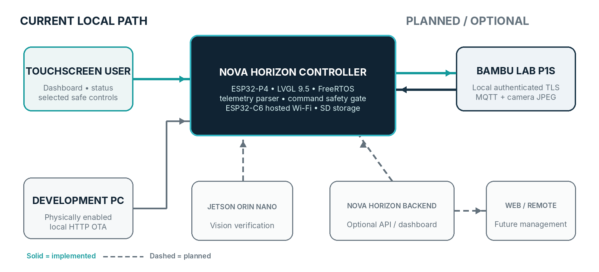

# NOVA HORIZON CONTROLLER

**An independent, local-first touchscreen controller prototype for monitoring and cautiously controlling Bambu Lab printers.**

**Independent Bambu Lab Controller Development Project** 
Prepared by **Dima** 
Firmware reviewed: **v0.7.1 deployed prototype build** | July 2026

> **IMAGE PLACEHOLDER — Current physical prototype**
> Replace with a clean landscape photograph of the powered controller.

*Bambu Lab is not currently affiliated with or responsible for this independent project.*

---

## 1. Project overview

Nova Horizon Controller is a dedicated touchscreen device being developed to put useful printer information and carefully gated controls on a small, always-available local display. The current prototype targets a Bambu Lab P1S and is intended to reduce the need to reach for a phone or computer for routine at-a-glance monitoring and selected printer actions.

The project is local-first: the working P1S integration communicates over the local network. The longer-term design leaves clear boundaries for optional Nova Horizon web services and a Jetson Orin Nano vision system, but neither is part of the current working printer path.

## 2. Current development status

| Category | Factual status |
| --- | --- |
| **Completed and verified** | Firmware builds for the JC4880P443 ESP32-P4 board; the 4.3-inch display, landscape LVGL interface, aligned capacitive touch, ESP32-C6 Wi-Fi connection, local P1S authentication, live print reporting, chamber-light control, local P1 camera liveview, and physically enabled LAN OTA have been exercised on the current prototype. |
| **Functional but still being refined** | P1S telemetry parsing and presentation, on-screen Wi-Fi/P1S setup, reconnect behavior, SD-card mounting, camera lifecycle, and UI status/error messaging. Signed v0.7.1 is deployed and reports stable short-duration health samples; full behavioral and long-duration regression remains pending. |
| **In active development** | Safe validation of pause/resume/cancel, credential-storage hardening, local file indexing and print initiation, and broader regression testing. |
| **Planned** | AMS/filament workflows, multi-printer profiles, optional Nova Horizon backend/dashboard connectivity, Jetson Orin Nano vision verification, and broader diagnostics. No current code claims these features are complete. |
| **Requires additional printer testing** | X-series and H-series discovery, authentication, telemetry, cameras, AMS generations, command behavior, firmware differences, error handling, and UI adaptation. |

> **IMAGE PLACEHOLDER — Current touchscreen interface**
> Replace with a straight-on photograph showing live P1S job telemetry.

---

## 3. Key planned capabilities

| Capability | Current state |
| --- | --- |
| Printer status and monitoring | **Working on P1S, refining:** connection/job state, progress, current/total layer, remaining time, nozzle/bed/chamber temperatures, part-fan level, and chamber-light state are parsed for the UI. |
| Job management | **Implemented, not fully printer-validated:** pause, resume, and cancel command paths exist; cancel requires confirmation. Chamber-light control is verified. |
| File selection and print initiation | **UI scaffold only:** SD storage can be mounted, but file indexing, transfer, queueing, and print initiation are not implemented. |
| Temperature, fan, and motion control | **Intentionally disabled:** controls are visible as design scaffolding but rejected by the transport until safely validated. |
| Camera and AI-assisted verification | **P1 camera working; AI planned:** an on-demand encrypted P1-family liveview is implemented with hardware JPEG decode and PPA scaling. No vision model or Jetson integration is present. |
| AMS / filament management | **Planned compatibility work:** no AMS parser or control workflow is currently implemented. |
| Multi-printer and remote management | **Planned:** current code is P1S-specific and stores one printer profile. Optional Nova Horizon backend/dashboard integration is a roadmap item, not a current capability. |
| Diagnostics | **Partial:** authentication, TLS/identity, offline, and general connection states are represented. v0.7.1 reports heap, task-stack, reset, uptime, coredump-partition, and OTA state; long-duration stress measurements and full printer error/HMS interpretation remain pending. |

## 4. Hardware and software architecture

The prototype uses a Guition JC4880P443 controller with an ESP32-P4NRW32, 32 MB PSRAM, 16 MB flash, an ESP32-C6 Wi-Fi coprocessor, a 4.3-inch 480 × 800 ST7701S MIPI-DSI display, GT911 capacitive touch, and a native SDMMC slot. The firmware is written for ESP-IDF 6.0.2 and FreeRTOS, with LVGL 9.5 rendering a landscape 800 × 480 interface.

The working printer path uses authenticated local TLS/MQTT. The controller checks the Bambu Lab certificate authority and the configured printer identity, subscribes to printer reports, and sends only the command types currently enabled by its safety gate. Release builds use RSA-signed OTA verification without enabling irreversible hardware Secure Boot. Wi-Fi and printer credentials are stored in NVS on the prototype; encrypted-at-rest storage requires a separately approved device-provisioning step.

**Legend:** solid lines are implemented in the current prototype; dashed lines are planned. No passwords, device identifiers, private addresses, or tokens are shown.

> **IMAGE PLACEHOLDER — Enclosure or hardware development**
> Replace with the controller PCB/display assembly or enclosure work.

---

## 5. Why additional printers are needed

Testing against one P1S can validate only one printer family and one set of firmware, telemetry, camera, accessory, and command behaviors. It cannot establish whether the same fields, command responses, reconnect behavior, error states, or interface assumptions hold across Bambu Lab’s X and H product families.

The highest-value temporary test units would be:

1. **Bambu Lab X1 Carbon, preferably with AMS.** It would add X-series authentication and firmware coverage plus higher-resolution chamber-camera and additional sensor behavior. Bambu Lab’s X1 Carbon technical specification identifies a 1080p chamber camera and Micro Lidar, both absent from the current P1S-specific controller implementation.
2. **Bambu Lab H2D, preferably with AMS 2 Pro.** It would provide the broadest H-series protocol challenge: dual-nozzle state, a newer sensor/camera architecture, active chamber functions, and newer filament-system behavior. These differences are particularly valuable for designing a model-capability layer rather than hard-coding one printer’s fields.

Together with the existing P1S, those units would provide broad P/X/H family coverage. They would **not** prove compatibility with every Bambu Lab model or SKU; A-series and per-model certification would remain separate work.

Official model references: [Bambu Lab P1S specification](https://cdn1.bambulab.com/documentation/quick-start-59b0cefdc0fc4/P1S/English%20version-Quick%20Start%20Guide%20for%20P1S.pdf), [Bambu Lab X1 Carbon technical specification](https://public-cdn.bambulab.com/store/bambulab-X1-carbon-tech-specs.pdf), and [Bambu Lab H2D technical data sheet](https://cdn1.bambulab.com/documentation/h2d/en/H2D_Laser_Full_Combo_20250305.pdf).

> **IMAGE PLACEHOLDER — Controller connected to Bambu Lab P1S**
> Replace with a wider photograph showing the prototype and existing printer together.

## 6. Proposed printer-loan arrangement

I am requesting one or two printers on a temporary development loan for compatibility development, validation, demonstrations, and preparation of accurate project media. The equipment would be kept in a clean, controlled development environment and used for normal printing, protocol observation, regression testing, and documented demonstrations. The planned LAN-integration work does not require permanent printer modification; I would follow applicable operating and maintenance guidance and document relevant configuration changes.

I am willing to comply with reasonable loan terms, provide periodic progress reports, and share compatibility findings and relevant technical feedback. The printers can be returned at the end of an agreed loan period unless a different arrangement is mutually agreed. This proposal is a request for discussion and does not presume approval, endorsement, sponsorship, or partnership.

---

## 7. Testing and validation plan

**Status key:** **Complete** = observed on the current prototype; **Partial** = implemented or observed with remaining tests; **HW dependent** = requires the requested printer.

| Test area | Existing P1S | X1 Carbon + AMS | H2D + AMS 2 Pro |
| --- | --- | --- | --- |
| Discovery and connection | **Partial:** manual profile and connection verified; discovery not implemented | **HW dependent** | **HW dependent** |
| Authentication / TLS / MQTT | **Complete** for current local profile | **HW dependent** | **HW dependent** |
| Job and temperature telemetry | **Partial:** live reporting observed; field/regression coverage continuing | **HW dependent** | **HW dependent**, including dual-nozzle state |
| Commands and safety gates | Chamber light **complete**; pause/resume/cancel pending safe test; motion/thermal/fan blocked | **HW dependent** | **HW dependent** |
| File handling / print launch | **Pending implementation** | **Pending implementation** | **Pending implementation** |
| Camera behavior | **Partial:** local P1 liveview is implemented and operator-confirmed; lifecycle and duration testing continue | **HW dependent** | **HW dependent**, including multiple camera roles |
| AMS / filament state | **Pending implementation** | **HW dependent** | **HW dependent** for AMS 2 Pro behavior |
| Error states and reconnection | **Partial:** code paths exist; systematic fault tests pending | **HW dependent** | **HW dependent** |
| Firmware compatibility and long-duration operation | **Pending test matrix** | **HW dependent** | **HW dependent** |
| UI adaptation and regression | P1S-focused UI working; refinement continues | **HW dependent** | **HW dependent** |

No destructive or safety-sensitive command would be exercised without an appropriate test setup, confirmation behavior, and a recoverable test job.

> **IMAGE PLACEHOLDER — Development and testing setup**
> Replace with a clean bench photograph showing the controller, printer, and development workstation.

## 8. Demonstration and promotional plan

After the project reaches a reliable demonstration stage, I plan to prepare a dedicated project website, regular development updates, prototype and compatibility demonstrations, product walkthroughs, and educational technical content. Outreach would include multiple 3D-printing and technology YouTube creators, social media content, and carefully targeted Meta advertising.

These are planned launch activities, not existing creator partnerships or guaranteed coverage. Bambu Lab would be acknowledged as a project supporter only if Bambu Lab agrees to the arrangement and approves the form of that acknowledgment.

---

## 9. Potential value to Bambu Lab

A successful independent controller could create additional community-driven use cases around Bambu Lab printers while generating practical compatibility feedback across printer families. The project may also support:

- More technical and demonstration content featuring the Bambu Lab ecosystem.
- Increased engagement from advanced users, makers, and integration-oriented customers.
- Earlier identification and documentation of cross-model compatibility issues.
- Clear demonstrations of responsible local printer integration and command gating.
- A reusable test record covering telemetry, cameras, accessories, firmware changes, and reconnection behavior.

These are potential outcomes, not claims of endorsement or guaranteed commercial impact.

## 10. Development roadmap

| Phase | Scope and exit condition |
| --- | --- |
| **Current — P1S prototype** | Hardware-regression test deployed v0.7.1 telemetry, reconnect, camera lifecycle, SD refresh, runtime health reporting, and guarded actions. |
| **Next technical milestone** | Safely validate supported job commands, harden credential storage, and implement a real local file browser/print-start path. |
| **Multi-printer compatibility** | Introduce model capability profiles; characterize X1 Carbon and H2D authentication, telemetry, cameras, AMS behavior, commands, and UI differences. |
| **Reliability and hardening** | Run reconnect, malformed/error-state, firmware-regression, long-duration, and safe-command tests; document known limitations. |
| **Creator demonstration** | Produce a presentable enclosure, repeatable demonstrations, accurate photography/video, and a public compatibility summary. |
| **Public launch preparation** | Finalize the project website, walkthroughs, support documentation, disclosures, and outreach materials. |

No completion dates are asserted; progress depends on hardware access and the results of compatibility testing.

## 11. Contact and next step

I would welcome a discussion about whether Bambu Lab would consider a temporary development loan of an X1 Carbon and/or H2D, ideally with their corresponding AMS systems, for the compatibility work described above.

**Dima** 
Email: **[INSERT EMAIL]** 
Phone: **[INSERT PHONE]** 
Project website: **[INSERT PROJECT WEBSITE]** 
Repository: **[INSERT GITHUB OR PRIVATE-DEMO LINK, IF SHARED]** 
Social links: **[INSERT SOCIAL LINKS]**

*Nova Horizon Controller is an independent development project. Bambu Lab is not currently affiliated with or responsible for it.*
